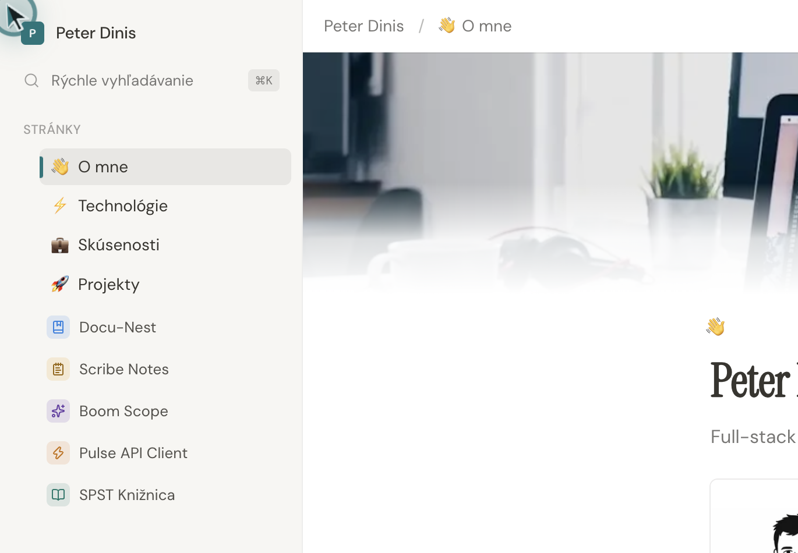
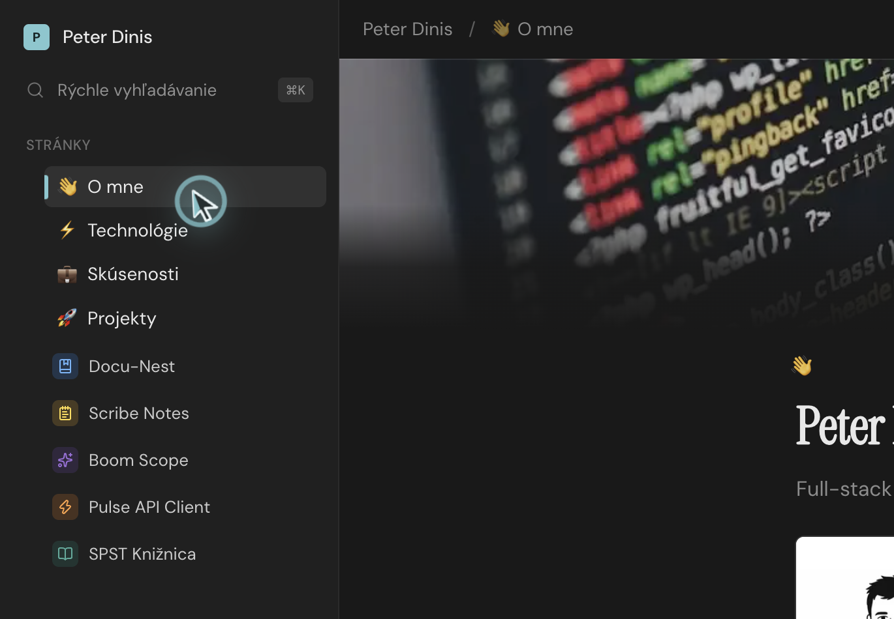
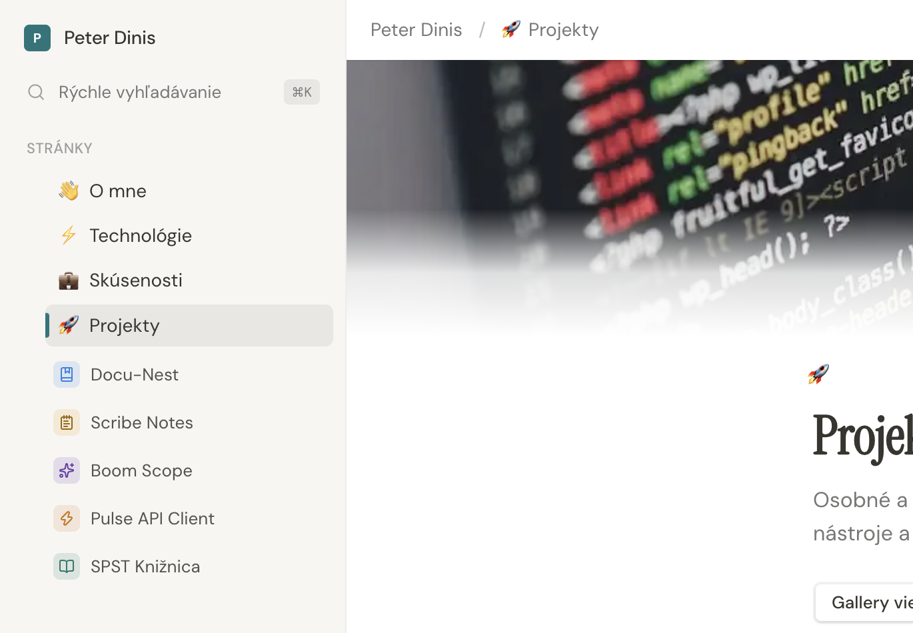
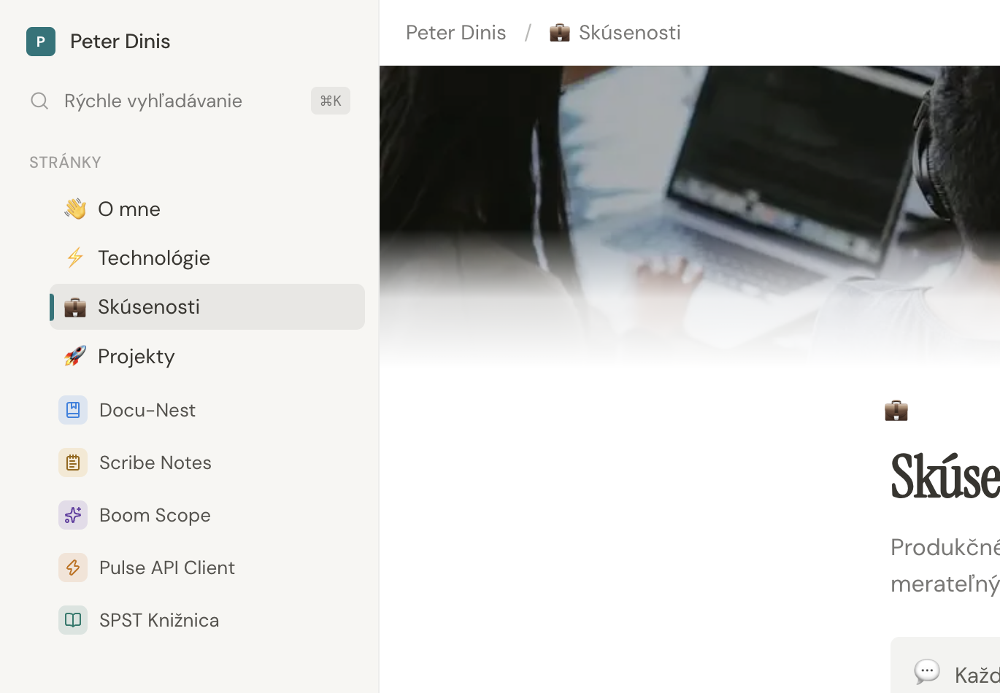
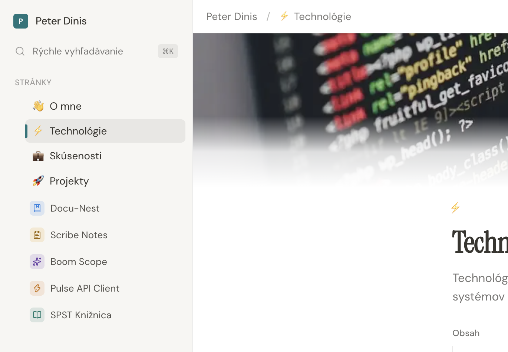
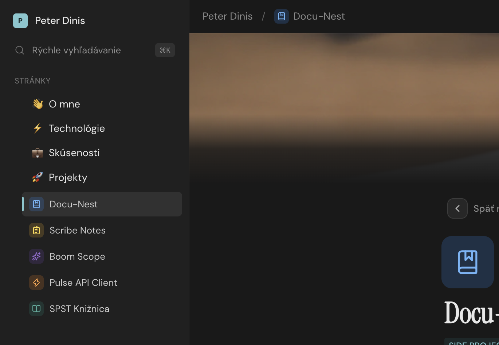

# Peter Dinis — Notion Portfolio

Interactive portfolio with a Notion-like layout: sidebar, document pages, locale URLs (`/sk`, `/en`), SK/EN toggle, and light/dark theme. Built with **Next.js App Router** and authored in React.

## Preview

| About (light) | About (dark) |
|:---:|:---:|
|  |  |

| Projects | Experience |
|:---:|:---:|
|  |  |

| Technologies | Project detail |
|:---:|:---:|
|  |  |

## Stack

| Layer | Tools |
|-------|--------|
| Framework | Next.js 16 (App Router), React 19, TypeScript |
| Styling | Tailwind CSS v4, shadcn/ui (Radix primitives) |
| Fonts | Instrument Serif (display), DM Sans (body) via `next/font` |
| Motion | Framer Motion (`MOTION_EASE`, `useEnterMotionReady` for SSR-safe enters) |
| State | XState (`@xstate/react`) — theme / animations |
| Icons | [simple-icons](https://simpleicons.org/) + Lucide |
| Quality | Biome, Vitest, Storybook |

## Getting started

**Requirements:** Node.js 20+

```bash
npm install
cp .env.example .env   # optional
npm run dev
```

Open [http://localhost:3000](http://localhost:3000) — middleware redirects `/` → `/sk` (or `/en` from cookie / `Accept-Language`).

### Production

```bash
npm run build
npm start
```

## How to use

| Input | Action |
|-------|--------|
| Sidebar / ⌘K | Navigate or quick-find pages, projects, notes, actions |
| ⌘\ | Collapse / expand sidebar (desktop) or open sheet (mobile) |
| Topbar | Search, SK/EN, animations on/off, theme |
| Locale URLs | `/sk/...` and `/en/...` (lang switch updates the path) |

Theme and animations persist in `localStorage` (`portfolio-theme`, `portfolio-animations`). Language lives in the URL (+ `NEXT_LOCALE` cookie).

## Pages

| Route | Content |
|-------|---------|
| `/[locale]` | About — bio, interests, services |
| `/[locale]/tech` | Stack |
| `/[locale]/experience` | Roles |
| `/[locale]/projects` | Project gallery |
| `/[locale]/projects/:id` | Project detail |
| `/[locale]/notes` | Blog list (`?q=&tag=&sort=&view=`) |
| `/[locale]/notes/:id` | Article |
| `/[locale]/cv` | Printable CV |
| `/[locale]/contact` | Contact |

## Project structure

```
app/
├── [locale]/          # Locale-prefixed routes + layout shell
├── feed.xml/          # Static RSS
├── sitemap.ts
└── robots.ts
src/
├── components/notion/ # Shell, pages, blocks, motion
├── components/ui/     # shadcn primitives
├── context/           # AppProviders (XState)
├── data/              # portfolio, notes, technologies
├── i18n/              # SK / EN copy
├── lib/               # seo, routing, locale
└── machines/          # settingsMachine (theme / animations)
```

## Motion conventions (DX)

- **`MOTION_EASE`** — `[0.22, 1, 0.36, 1]` soft expo (Notion-like, not bouncy).
- **`useEnterMotionReady()`** — keep enter `initial` as `false` until after mount so prerendered HTML stays visible (no `opacity: 0` in SSG).
- **`data-motion-ready`** on `.notion-app-shell` — gates CSS gallery rise animations the same way.
- Respect **`useMotionDisabled()`** (OS reduced-motion or user toggle).

## Customize content

| What | Where |
|------|--------|
| Profile, projects, socials | `src/data/portfolio.ts` |
| Notes / blog | `src/data/notes.ts` |
| Tech stack | `src/data/technologies.ts` |
| UI copy (SK / EN) | `src/i18n/translations.ts` |
| Pages | `src/components/notion/pages/` |
| Nav | `src/components/notion/nav.ts` |

## Scripts

| Command | Description |
|---------|-------------|
| `npm run dev` | Next.js dev server |
| `npm run build` | OG images + `next build` (SSG) |
| `npm start` | Production server |
| `npm run verify` | `tsc` + Biome CI + Vitest |
| `npm run storybook` | Component stories (Vite) |
| `npm run og:generate` | Regenerate `public/og/*.svg` |

## SEO

- Per-route `generateMetadata` + hreflang alternates (`/sk` ↔ `/en`)
- JSON-LD in prerendered HTML (`JsonLd`)
- `app/sitemap.ts`, `app/robots.ts`, `/feed.xml`

```bash
cp .env.example .env
# NEXT_PUBLIC_SITE_URL=https://your-domain.com
```

## License

Private project — Peter Dinis © 2026
